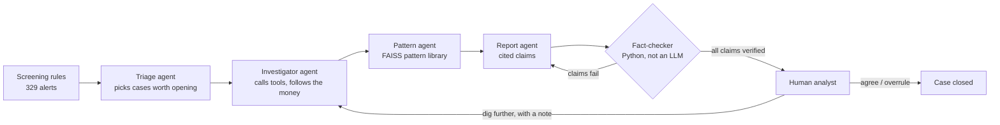

# Parakh

**A team of AI agents that investigates suspicious bank accounts the way a human anti-money-laundering analyst would.**

Banks run screening rules that flag accounts for possible money laundering. Most of those alerts are false alarms (an employer on salary day, a busy wholesale distributor, someone moving a bonus to their broker), and each one costs an analyst hours of digging through transactions. Parakh hands each alert to a team of agents that follow the money, test innocent explanations, match the evidence against known laundering patterns and write a case file where **every claim is fact-checked in code against the actual transactions**. A human analyst makes the final call.

*Parakh (परख) means to assay or test the true worth of something.*

---

## How it works



| Agent | What it does |
|---|---|
| **Triage** | Reads rule alerts in batches and decides which deserve a full investigation, within a case budget. |
| **Investigator** | A tool-calling loop with a hard budget (default 8 calls). Uses five tools: account profile, transaction search, time-ordered money tracing, loop detection and shared-destination detection. Is told to actively test innocent explanations. |
| **Pattern agent** | Retrieves the closest typologies from a FAISS index that contains laundering patterns *and* innocent look-alikes (payroll, wholesale trade, investment transfers, property purchases, family transfers), then picks one and lists what it ruled out. |
| **Report agent** | Writes a structured case file. Every claim must cite transaction IDs. |
| **Fact-checker** | Plain Python. Checks that cited transactions exist, involve the accounts named, and that every amount and count matches. Failing reports go back to the report agent (up to 2 retries). |
| **Human review** | The LangGraph run pauses (`interrupt`). The analyst agrees, overrules, or sends the agents back with instructions, which resumes the same run. |

### Design decisions worth knowing

- **Tools return summaries, not data.** An LLM can't read 60,000 transactions. Each tool compresses what matters (for example "8 recipients all forwarded money to AC985490 within 72 hours") and attaches the transaction IDs behind it.
- **Fact-checking is code, not another LLM.** Claims are structured (`statement`, `txn_ids`, `accounts`, `amount`, `count`), so they can be checked with arithmetic. The checker understands Indian amounts (₹9.5 lakh, ₹1.2 crore, ₹66,41,114) and ignores dates and IDs.
- **No label leakage.** Ground-truth labels are split off when data loads and are only visible to the evaluation code. Synthetic account IDs are neutral (`AC123456`), so names can't reveal which accounts are mules.
- **Hard budgets everywhere.** Tool calls per case, report retries and cases per run are capped, so cost per case is predictable.
- **Survives restarts.** If the server restarts while a case waits for review, the decision is still applied from the stored case; a "dig further" request opens a fresh investigation.

## Data

**Synthetic demo data** (`backend/data/demo_transactions.csv.gz`): 62k transactions over 60 days, made by `parakh/data/generator.py`. It contains 36 planted laundering schemes across six typologies (fan-out, fan-in, round-trip loops, scatter-gather, gather-scatter, layering chains), plus innocent accounts that deliberately trip the same rules: employers on payday, wholesale distributors, investors, home buyers and families moving money between themselves.

**IBM AML dataset** for real evaluation. Download `HI-Small_Trans.csv` and `HI-Small_Patterns.txt` from Kaggle ("IBM Transactions for Anti Money Laundering"), then:

```bash
cd backend
python -m parakh.data.ibm_loader --trans HI-Small_Trans.csv --patterns HI-Small_Patterns.txt --out data/ibm_sample.csv.gz --days 10
DATA_PATH=data/ibm_sample.csv.gz python -m parakh.eval.run_eval --sample 40
```

## Evaluation

`python -m parakh.eval.run_eval` runs every setup on the **same** random sample of rule alerts and reports precision, recall, pattern accuracy, the share of report claims that survive fact-checking, tokens, cost and time per case. It also breaks false alarms down by account type, which is where the failure analysis starts.

| Setup | What it isolates |
|---|---|
| `rules` | Screening rules alone (score ≥ 2 means suspicious) |
| `single` | One agent with every tool; no pattern agent; fact-checking measured but not enforced |
| `multi_noverify` | Full agent team; fact-checking measured but not enforced |
| `multi` | Full agent team with the fact-checking loop |

**Rules-only baseline on the demo data** (all 329 alerts):

| Setup | Precision | Recall | F1 | Pattern accuracy |
|---|---|---|---|---|
| rules | 69% | 42% | 0.52 | 52% |

The rules miss most laundering accounts that trip only one signal (typically the middle accounts of a scheme), and their false alarms are wholesale distributors and ordinary customers. That gap is what the agents are measured against. Agent results depend on the model and are produced by running the script with an API key; record them here after running.

### Failure analysis

After a run, `results/eval_*.json` holds every case with the agents' verdict, cited claims, fact-check results and the account's true role. Things to look at:
- false alarms grouped by account type (which innocent behaviour fools the agents)
- laundering patterns the agents miss or mislabel
- how many claims the fact-checker rejected with and without the retry loop

## Run it locally

**Backend** (Python 3.11+):

```bash
cd backend
python -m venv .venv && source .venv/bin/activate
pip install -r requirements-dev.txt
cp .env.example .env        # add your GROQ_API_KEY (free at console.groq.com)
uvicorn parakh.api.main:app --reload
pytest -q                   # 29 tests, no API key needed (uses a scripted fake model)
```

**Dashboard**:

```bash
cd frontend
npm install
cp .env.example .env        # VITE_API_URL=http://localhost:8000
npm run dev
```

## Deploy

1. **Database:** create a free MongoDB Atlas cluster and copy its connection string. Without one, cases are kept in memory.
2. **API on Render:** New > Blueprint > choose this repository. `render.yaml` sets everything up; enter `GROQ_API_KEY`, `MONGODB_URI` and `CORS_ORIGINS` (your Vercel URL) when asked.
3. **Dashboard on Vercel:** import the repository, set the root directory to `frontend`, and add `VITE_API_URL` = your Render URL.

Render's free plan sleeps after 15 minutes without traffic, so the first request afterwards takes about a minute.

## Project structure

```
backend/
  parakh/
    data/        generator, IBM loader, transaction store (labels kept separate)
    tools/       screening rules, investigation tools
    patterns/    typology library + FAISS index
    agents/      LangGraph graph, prompts, schemas, fact-checker, triage, service
    storage/     MongoDB / in-memory case storage
    api/         FastAPI app
    eval/        experiment runner
  tests/         pytest suite with a scripted fake LLM
frontend/        React + TypeScript dashboard (Vite)
```

## Tech

LangGraph, LangChain, Groq (Llama 3.3 70B) or Gemini, FAISS, NetworkX, Pandas, FastAPI, Pydantic, MongoDB, React, TypeScript, Vite, pytest, GitHub Actions, Render, Vercel.

## Limitations

- The demo data is synthetic. It is built to be hard for rules, but real bank data is messier.
- The fact-checker verifies amounts, counts, accounts and transaction IDs; it does not verify timing claims ("within 3 hours") yet.
- LangGraph checkpoints are in memory, so a paused run does not survive a restart (decisions still do).
