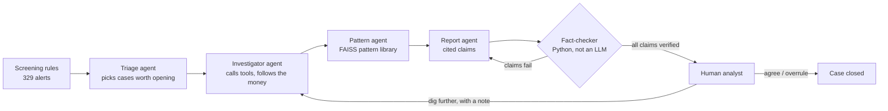

# Parakh

**A team of AI agents that investigates suspicious bank accounts the way a human anti-money-laundering analyst would.**

Banks run screening rules that flag accounts for possible money laundering. Most of those alerts are false alarms (an employer on salary day, a busy wholesale distributor, someone moving a bonus to their broker), and each one costs an analyst hours of digging through transactions. Parakh hands each alert to a team of agents that follow the money, test innocent explanations, match the evidence against known laundering patterns and write a case file where **every claim is fact-checked in code against the actual transactions**. A human analyst makes the final call.

*Parakh (परख) means to assay or test the true worth of something.*

---

## How it works



| Agent | What it does |
|---|---|
| **Triage** | Reads rule alerts in batches and decides which deserve a full investigation, within a case budget. |
| **Investigator** | A tool-calling loop with a hard budget (default 6 calls). Uses five tools: account profile, transaction search, time-ordered money tracing, loop detection and shared-destination detection. Is told to actively test innocent explanations. |
| **Pattern agent** | Code first measures the shape of the money flow (senders, recipients, repeat counterparties, payment regularity, loops) and rules out every typology that shape makes impossible. FAISS adds library matches for the investigator's story. The agent then chooses among what is left, laundering pattern or innocent look-alike, and explains why. If it picks an impossible pattern twice, the best structural fit is used and the trail says so. |
| **Report agent** | Writes a structured case file. Every claim must cite transaction IDs. |
| **Fact-checker** | Plain Python. Checks that cited transactions exist, involve the accounts named, and that every amount and count matches. "Nothing found" results (no loops, no shared destinations) are listed separately and accepted only if the investigator really ran the tool that would have found them. Failing reports go back to the report agent (up to 2 retries). |
| **Human review** | The LangGraph run pauses (`interrupt`). The analyst agrees, overrules, or sends the agents back with instructions, which resumes the same run. |

### The analyst dashboard

- **Summary strip:** money in, money out, share passed straight through, time span, claims verified.
- **Where the money went:** a flow graph of senders and recipients around the case account. Band width is the amount; gold bands are transactions the report cites, and clicking one jumps to it.
- **Live agent trail:** while a case runs, each tool call appears as it happens. Afterwards the trail collapses to a one-line story with the full audit log one click away.
- **Evidence:** every claim with its fact-check result, plus what was checked and not found.
- **Decision:** agree, overrule, or send the agents back with a note.

### Design decisions worth knowing

- **Tools return summaries, not data.** An LLM can't read 60,000 transactions. Each tool compresses what matters (for example "8 recipients all forwarded money to AC985490 within 72 hours") and attaches the transaction IDs behind it.
- **Agents choose evidence; code does arithmetic.** The report agent writes `{total}` and `{count}` instead of numbers, and code fills them in from the cited transactions. In early runs the model added up its own totals and was off by a few hundred rupees on almost every try; now it cannot be. If a claim still carries a wrong total after the retries, the fact-checker corrects it from the cited transactions and shows the original next to it.
- **Fact-checking is code, not another LLM.** Claims are structured (`statement`, `txn_ids`, `accounts`, `amount`, `count`), so they can be checked with arithmetic. The checker understands Indian amounts (₹9.5 lakh, ₹1.2 crore, ₹66,41,114) and ignores dates and IDs.
- **No label leakage.** Ground-truth labels are split off when data loads and are only visible to the evaluation code. Synthetic account IDs are neutral (`AC123456`), so names can't reveal which accounts are mules.
- **Hard budgets everywhere.** Tool calls per case, report retries and cases per run are capped, so cost per case is predictable.
- **Lean prompts.** The report agent gets a compact ledger of every transaction the tools surfaced, looked up again in the data, rather than raw tool output. This cut tokens per case sharply, which matters on Groq's free tier (8,000 tokens per minute).
- **Survives restarts.** If the server restarts while a case waits for review, the decision is still applied from the stored case; a "dig further" request opens a fresh investigation.

## Data

**Synthetic demo data** (`backend/data/demo_transactions.csv.gz`): 62k transactions over 60 days, made by `parakh/data/generator.py`. It contains 36 planted laundering schemes across six typologies (fan-out, fan-in, round-trip loops, scatter-gather, gather-scatter, layering chains), plus innocent accounts that deliberately trip the same rules: employers on payday, wholesale distributors, investors, home buyers and families moving money between themselves.

**IBM AML dataset** for real evaluation. Download `HI-Small_Trans.csv` and `HI-Small_Patterns.txt` from Kaggle ("IBM Transactions for Anti Money Laundering"), then:

```bash
cd backend
python -m parakh.data.ibm_loader --trans HI-Small_Trans.csv --patterns HI-Small_Patterns.txt --out data/ibm_sample.csv.gz --days 10
DATA_PATH=data/ibm_sample.csv.gz python -m parakh.eval.run_eval --sample 40
```

## Evaluation

`python -m parakh.eval.run_eval` puts the **same** balanced sample of rule alerts (half truly laundering, half innocent look-alikes) through four setups and checks every verdict against the answer key in the data:

| Setup | What it isolates |
|---|---|
| Screening rules alone | The baseline every bank already has |
| One agent with every tool | Whether splitting the work across specialised agents helps |
| Agent team, agents decide everything | What the agents get right with no code checking them (no shape rules, no fact-check loop) |
| Agent team with shape rules and fact-check loop | What the code-enforced guardrails add (this is what the app runs) |

It reports precision, recall, the share of innocent look-alikes correctly cleared, pattern accuracy, how many claims were verified, corrected or removed, tokens, cost and time per case, and which kinds of account each setup gets wrong. Results are shown on the dashboard's **Evaluation** page.

Every case is saved the moment it finishes, so the run survives Groq's free-tier daily limit: when the limit is hit it stops cleanly, and the same command continues the next day.

```bash
python -m parakh.eval.run_eval --name demo --sample 30      # run or resume
python -m parakh.eval.run_eval --name demo --summarise      # rebuild the summary only
```

**Results so far** (demo data, 30 alerts, 15 truly laundering):

- The screening rules flag only **58%** of laundering accounts at all (184 of 318), which caps what any setup can catch.
- On the sample, the rules alone reach 77% precision and 67% recall, clear 80% of innocent look-alikes, and miss mostly scatter-gather schemes.
- The agent setups are being run; their numbers will be added here.

### What broke, and what I changed

| Problem seen in real runs | Fix | Test |
|---|---|---|
| The report agent added up its own totals and was off by a few hundred rupees on nearly every try (₹64,07,564 for a true ₹64,07,207) | The agent writes `{total}` and `{count}`; code fills in the numbers. Wrong totals that still slip through are corrected from the cited transactions and shown | `test_wrong_arithmetic_never_reaches_the_analyst` |
| A hub with 8 senders and 6 recipients was labelled fan-in, then "no pattern fits" | Code measures the flow's shape and removes impossible typologies before the agent chooses; two impossible picks fall back to the best structural fit | `test_hub_is_gather_scatter_even_when_the_agent_says_fan_out_then_none` |
| A wholesale distributor was flagged suspicious with a risk score of 82 | Account profiles measure repeat counterparties, the largest recipient's share and payment regularity; innocent patterns must fit them | `test_distributor_is_wholesale_and_not_suspicious` |
| A claim said "eight distinct senders" for seven, and cited one payment twice | Counts written in words or digits are fact-checked and corrected; duplicate citations are dropped | `test_miscounted_senders_and_duplicate_citation_from_real_run` |

## Run it locally

**Backend** (Python 3.11+):

```bash
cd backend
python -m venv .venv && source .venv/bin/activate
pip install -r requirements-dev.txt
cp .env.example .env        # add your GROQ_API_KEY (free at console.groq.com)
uvicorn parakh.api.main:app --reload
pytest -q                   # 49 tests, no API key needed (scripted and deliberately misbehaving fake models)
```

**Dashboard**:

```bash
cd frontend
npm install
cp .env.example .env        # VITE_API_URL=http://localhost:8000
npm run dev
```

## Deploy

1. **Database:** create a free MongoDB Atlas cluster and copy its connection string. Without one, cases are kept in memory.
2. **API on Render:** New > Blueprint > choose this repository. `render.yaml` sets everything up; enter `GROQ_API_KEY`, `MONGODB_URI` and `CORS_ORIGINS` (your Vercel URL) when asked.
3. **Dashboard on Vercel:** import the repository, set the root directory to `frontend`, and add `VITE_API_URL` = your Render URL.

Groq's free tier allows about 8,000 tokens per minute and 200,000 per day for `openai/gpt-oss-120b`, so investigate a few cases at a time.

Render's free plan sleeps after 15 minutes without traffic, so the first request afterwards takes about a minute.

## Project structure

```
backend/
  parakh/
    data/        generator, IBM loader, transaction store (labels kept separate)
    tools/       screening rules, investigation tools
    patterns/    typology library + FAISS index
    agents/      LangGraph graph, prompts, schemas, fact-checker, triage, service
    storage/     MongoDB / in-memory case storage
    api/         FastAPI app
    eval/        experiment runner
  tests/         pytest suite with a scripted fake LLM
frontend/        React + TypeScript dashboard (Vite)
```

## Tech

LangGraph, LangChain, Groq (GPT-OSS 120B) or Gemini, FAISS, NetworkX, Pandas, FastAPI, Pydantic, MongoDB, React, TypeScript, Vite, pytest, GitHub Actions, Render, Vercel.

## Limitations

- The demo data is synthetic. It is built to be hard for rules, but real bank data is messier.
- The fact-checker verifies amounts, counts, accounts and transaction IDs; it does not verify timing claims ("within 3 hours") yet.
- LangGraph checkpoints are in memory, so a paused run does not survive a restart (decisions still do).
